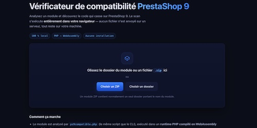

# 

<a id="top"></a>

## 👤 Auteur

👤 **Thierry LAVAL** — [Contact](mailto:contact@thierrylaval.dev)

* GitHub : [@Thierry Laval](https://github.com/thierry-laval)
* LinkedIn : [Thierry Laval](https://www.linkedin.com/in/thierry-laval)
* Site Web : [thierrylaval.dev](https://thierrylaval.dev)

---

## 📎 Projet

**Vérificateur de compatibilité PrestaShop 9 pour modules et thèmes** audit statique du code qui empêche l'installation ou le fonctionnement d'un module sur PrestaShop 9.

_Script `ps9compatible.php` + classes `src/Ps9Compatible/` + base `data/removed-api.php` (+ interface web WASM dans `web/`)_ — Version : **2.0.0** · Licence : **AFL-3.0**

_`Début du projet le 17/10/2026`_



### Table des matières

| Sommaire | Suite |
| :--- | :--- |
| 1. [À propos du projet](#à-propos-du-projet) | 15. [Utilisation — Interface web](#utilisation--interface-web) |
| 2. [Fonctionnalités](#fonctionnalités) | 16. [Utilisation — Ligne de commande (CLI)](#utilisation--ligne-de-commande-cli) |
| 3. [Prérequis](#prérequis) | 17. [Moteur de détection](#moteur-de-détection) |
| 4. [Installation](#installation) | 18. [Base de connaissances](#base-de-connaissances) |
| 5. [Configuration](#configuration) | 19. [Cache](#cache) |
| 6. [Exclusions (faux positifs)](#exclusions-faux-positifs) | 20. [Formats de sortie](#formats-de-sortie) |
| 7. [Données stockées](#données-stockées) | 21. [Architecture](#architecture) |
| 8. [Fichiers et répertoires importants](#fichiers-et-répertoires-importants) | 22. [Intégration en CI](#intégration-en-ci) |
| 9. [Ce qui est vérifié](#ce-qui-est-vérifié) | 23. [Limites](#limites) |
| 10. [Sécurité](#sécurité) | 24. [Dépannage](#dépannage) |
| 11. [Variables d'environnement et configuration](#variables-denvironnement-et-configuration) | 25. [Feuille de route](#feuille-de-route) |
| 12. [API et services externes](#api-et-services-externes) | 26. [Licence](#licence) |
| 13. [Identifiants et comptes](#identifiants-et-comptes) | 27. [Avertissement](#avertissement) |
| 14. [Mise à jour](#mise-à-jour) | 28. [Résumé de l'installation](#résumé-de-linstallation) |
| 15. [Utilisation — Interface web](#utilisation--interface-web) | 29. [Merci à tous](#merci-à-tous) |
| 16. [Publication sur GitHub Pages](#-publication-sur-github-pages) |                               |

<details>
<summary><h3>📖 À propos du projet</h3></summary>

**ps9compatible** analyse un module ou un thème PrestaShop (dossier ou archive ZIP) et liste le code qui empêche son installation ou son fonctionnement sur PrestaShop 9 : classes, méthodes, constantes et hooks supprimés du core, présentateurs déplacés, fonctions PHP supprimées en 8.0, dépréciées en 8.1/8.2, directives INI disparues, pièges des thèmes (classic → Hummingbird), templates Smarty, JavaScript et déclarations de compatibilité `config.xml`.

Le type de cible est **détecté automatiquement** : un dossier contenant `config.xml` à la racine est traité comme un module, un dossier contenant `theme.yml` (racine ou `config/`) et un dossier `templates/` est traité comme un thème. L'option `--type` (et le sélecteur « Type de cible » de l'interface web) permet de forcer le choix en cas de détection ambiguë.

Le projet s'utilise de deux façons :

* **En navigateur**, avec une interface web autonome qui exécute le scanner directement dans la page grâce à PHP compilé en WebAssembly. Aucun fichier n'est envoyé sur un serveur : le module analysé ne quitte jamais la machine du visiteur.
* **En ligne de commande**, avec un rapport texte coloré, des sorties JSON/Markdown/SARIF et des codes de sortie exploitables par un cron ou une CI.

Aucun compte, aucune clé API et aucun service payant ne sont requis. Le scanner n'a besoin ni de PrestaShop, ni de Composer pour fonctionner : il ne lit les sources PrestaShop que pour reconstruire sa base de connaissances.

> **Périmètre :** l'analyse est **statique**. Le code du module n'est jamais exécuté : les fichiers sont seulement lus et découpés en tokens par le tokenizer PHP (`token_get_all`). Un audit statique **oriente** les vérifications, il ne garantit pas qu'un module fonctionnera sur PrestaShop 9.

> ⚠️ **Un audit ne remplace pas un test réel :** installez toujours le module sur une copie de la boutique avant de mettre à jour en production.

Le moteur est regroupé dans `ps9compatible.php` et ses classes dans `src/Ps9Compatible/`. La liste des éléments supprimés du core est isolée dans `data/removed-api.php`, afin de pouvoir être reconstruite sans toucher au code.

<details>
<summary><h3>✨ Fonctionnalités</h3></summary>

* **Analyse par tokenizer PHP** (`token_get_all`) et non par simple recherche de texte : les faux positifs dans les chaînes et les commentaires sont évités.
* **Table de symboles construite en une passe** : namespaces, alias `use`, classes, héritage, méthodes propres et surcharges (override).
* **Classes du core supprimées** en PrestaShop 8.0 ou 9.0, détectées dans `new`, `extends`, `use`, `instanceof` et les appels statiques.
* **Présentateurs déplacés** : le nouveau namespace est indiqué dans le rapport.
* **Méthodes du core supprimées** appelées statiquement (`Tools::displayPrice()`, `Tools::encrypt()`, `Configuration::getInt()`…).
* **Méthodes héritées disparues** : appels `$this->…()` et `parent::…()` à des méthodes que la classe parente du core ne possède plus.
* **Constantes de classe supprimées** (ex. `Cart::ONLY_PRODUCTS_WITHOUT_SHIPPING`).
* **Hooks supprimés** en PrestaShop 8 ou 9, détectés dans `registerHook()` **et** dans les méthodes `hookXxx()`.
* **Surcharges orphelines** : overrides de méthodes du core qui n'existent plus, donc jamais appelés.
* **Déclarations de compatibilité** `ps_versions_compliancy` dont le `max` bloque l'installation sur PrestaShop 9.
* **Fonctions PHP supprimées en 8.0** (`create_function`, `each`, `money_format`…) et **dépréciées en 8.1/8.2**.
* **Directives INI disparues**, repérées dans les appels `ini_set()` du module.
* **Pièges des thèmes** : `prestashop.blockcart.showModal` (casse sur Hummingbird avec du HTML de module), `{include file=$tpl_dir…}`.
* **Templates Smarty** : sortie non filtrée `{… nofilter}`, signalée par la revue de sécurité Addons.
* **Analyse du JavaScript, du SQL et de `config.xml`**.
* **Cache par empreinte SHA-256** : les relances ne réanalysent que ce qui a réellement changé (`--cache` / `--no-cache`).
* **Quatre formats de sortie** : texte, JSON, Markdown, SARIF.
* **Seuil d'échec configurable** (`--fail-on`) et codes de sortie exploitables en CI.
* **Interface web autonome** qui exécute le scanner dans le navigateur (PHP-WASM), sans aucune API externe.

</details>

<details>
<summary><h3>🧰 Prérequis</h3></summary>

#### PHP

* **PHP 7.4 ou supérieur** (testé jusqu'à PHP 8.5). Le script gère explicitement les différences entre versions : les constantes de tokens introduites en PHP 8 sont définies avec une valeur inoffensive si elles manquent.
* Extension `tokenizer` — **indispensable** : c'est le cœur de l'analyse. Elle est activée par défaut dans PHP.
* Extension `zip` — nécessaire uniquement si vous passez une archive `.zip` au lieu d'un dossier.
* Fonctions standard utilisées : `token_get_all`, `preg_match`, `hash`, `file_get_contents`, `RecursiveDirectoryIterator`.
* `set_time_limit(600)` : le scan dispose de 10 minutes, de quoi couvrir un module de plusieurs milliers de fichiers.
* `memory_limit` relevé à `512M` si l'hébergement l'autorise ; l'opération est tentée sans jamais faire échouer le script.

#### Navigateur (interface web)

* Un navigateur supportant **WebAssembly** et `DecompressionStream` (Chrome, Firefox, Safari, Edge — versions récentes).
* **Node.js 20 ou supérieur** uniquement pour construire l'interface (`web/`). L'interface publiée est un ensemble de fichiers statiques : aucun serveur PHP n'est nécessaire.
* Aucun serveur, aucune base de données, aucun compte : la page fonctionne en local ou sur n'importe quel hébergement statique.

#### Hébergement (ligne de commande)

* Un serveur exécutant PHP (Apache, Nginx, LiteSpeed…).
* Un accès en lecture aux fichiers du module à analyser.
* L'écriture n'est nécessaire que pour le **cache** (dossier `.ps9compatible-cache/`), désactivable avec `--no-cache`.

</details>

<details>
<summary><h3>🚀 Installation</h3></summary>

#### 1. Récupérer le projet

```text
ps9compatible.php
src/Ps9Compatible/{Rules,SymbolTable,Cache,Reporter,Scanner,Cli}.php
data/removed-api.php
tools/build-data.php
img/                     # images (logo, captures)
web/                     # interface navigateur (optionnelle)
README.md
LICENSE
.gitignore
```

Aucun Composer, aucun `npm install` n'est nécessaire pour la ligne de commande : le scanner est autonome.

#### 2. Lancer un premier scan

```bash
php ps9compatible.php /chemin/vers/mon-module
```

Ou, avec une archive :

```bash
php ps9compatible.php ~/Téléchargements/mon-module.zip
```

Le rapport s'affiche dans le terminal. Le code de sortie vaut `0` si le module est conforme, `1` si au moins un constat atteint le seuil `--fail-on`, `2` en cas d'erreur d'usage.

#### 3. Interface web (optionnelle)

```bash
cd web
npm install
npm run dev      # serveur de développement
npm run build    # génère docs/, publié par GitHub Pages
```

Le script `npm run build` copie au préalable `ps9compatible.php`, `src/` et `data/` dans `web/public/php/`, et `img/logo.png` dans `web/public/img/` : le scanner et le logo restent des **sources de vérité uniques**, aucune copie manuelle à maintenir.

Ouvrez ensuite `docs/index.html` (ou servez le dossier `docs`).

#### 4. Vérifier l'installation

* En CLI : `php ps9compatible.php --version` doit afficher `ps9compatible 2.0.0`.
* En CLI : `php ps9compatible.php --help` affiche l'aide complète.
* Dans le navigateur : la mention « Moteur prêt. » doit apparaître après le chargement du runtime PHP (quelques secondes).
* En cas d'échec, consultez la section [Dépannage](#dépannage).

</details>

<details>
<summary><h3>⚙️ Configuration</h3></summary>

Il n'existe ni fichier `.env`, ni compte administrateur, ni base de données à configurer. Tout passe par les options de la ligne de commande, ou par l'interface web pour la version navigateur.

| Réglage | Emplacement | Rôle |
| --- | --- | --- |
| `PS9COMPATIBLE_VERSION` | constante en tête de `ps9compatible.php` | Version du moteur, affichée dans le rapport. **Source unique de vérité** : ne modifiez que celle-ci. |
| `PS9COMPATIBLE_DATA_VERSION` | constante en tête de `ps9compatible.php` | Version de la base de connaissances. Si elle diverge de celle de `data/removed-api.php`, un avertissement est signalé. |
| `data/removed-api.php` | fichier externe | Base de connaissances : classes, méthodes, constantes et hooks supprimés du core, avec la version de disparition. |
| `src/Ps9Compatible/Rules.php` | classe | Motifs d'exclusion, extensions analysées, niveaux de gravité et règles complémentaires. |
| `--ignore=<motif,motif>` | option CLI | Ignorer les fichiers correspondant à ces motifs (séparés par des virgules). |
| `--rules=<fichier.php>` | option CLI | Charger un fichier de règles complémentaire, sans modifier le code. |
| `--cache=<dossier>` | option CLI | Dossier du cache (défaut : `.ps9compatible-cache`). |
| `--no-cache` | option CLI | Désactiver complètement le cache. Comportement utilisé par l'interface web. |

#### Options de la ligne de commande

| Option | Effet |
| --- | --- |
| `--format=text\|json\|md\|sarif` | Format de sortie (`text` par défaut) |
| `--include-vendor` | Analyser aussi le dossier `vendor/` |
| `--no-color` | Sortie texte sans codes couleur |
| `--cache=<dossier>` | Dossier de cache (défaut : `.ps9compatible-cache`) |
| `--no-cache` | Désactiver le cache |
| `--min-severity=error\|warning\|notice` | Masquer les constats moins graves |
| `--type=auto\|module\|theme` | Forcer le type de cible (détection automatique par défaut) |
| `--ignore=<motif,motif>` | Ignorer les fichiers correspondant à ces motifs |
| `--rules=<fichier.php>` | Charger un fichier de règles complémentaire |
| `--fail-on=error\|warning\|notice` | Seuil de sortie en code 1 (défaut : `error`) |
| `--changed-since=<référence>` | Lister les fichiers modifiés depuis la dernière analyse |
| `--stats` | Afficher les statistiques d'analyse |
| `--help`, `-h` | Afficher l'aide |
| `--version`, `-v` | Afficher la version du moteur |

La variable d'environnement `NO_COLOR` est respectée : si elle est définie, la sortie texte n'utilise aucun code couleur.

</details>

<details>
<summary><h3>🚫 Exclusions (faux positifs)</h3></summary>

Le scanner applique des exclusions pour éviter le bruit et concentrer le rapport sur ce qui compte :

* **Dossier `vendor/`** : ignoré par défaut, car il s'agit de code tiers. Utilisez `--include-vendor` pour l'analyser aussi.
* **Dossiers exclus** : définis dans `src/Ps9Compatible/Rules.php` (cache, dépendances, binaires…).
* **JavaScript minifié** : détecté par motif et ignoré, car illisible et non pertinent pour l'audit.
* **Extensions analysées** : `.php`, `.tpl`, `.js`, `.sql`, plus `config.xml`, `php.ini` et `.user.ini`.
* **Motifs personnalisés** : `--ignore=chemin1,chemin2` pour exclure vos propres cas.
* **Règles complémentaires** : `--rules=mes-regles.php` pour reclasser ou ajouter des règles sans toucher au code.

> ⚠️ **N'excluez jamais un dossier entier sans raison précise** : vous masqueriez des détections réelles. Privilégiez des motifs de chemin précis.

</details>

<details>
<summary><h3>💾 Données stockées</h3></summary>

Le scanner **ne stocke aucune donnée de façon persistante**, à une exception près : le cache d'analyse.

| Donnée | Emplacement | Format | Contenu |
| --- | --- | --- | --- |
| Cache d'analyse | `.ps9compatible-cache/index.json` (ou `--cache=<dossier>`) | JSON | Empreinte SHA-256 et constats par fichier, pour éviter de réanalyser un fichier inchangé. Désactivable avec `--no-cache`. |
| Rapport | Flux de sortie (terminal) ou téléchargement depuis l'interface web | Texte / JSON / Markdown / SARIF | Constats du scan, métadonnées et statistiques. |
| Résultats en mémoire | Processus PHP uniquement | Tableaux PHP | Détruits à la fin de l'exécution. |

Le cache est un simple fichier JSON. Sa version de format est vérifiée au chargement : un fichier écrit par une version antérieure est **ignoré silencieusement** plutôt que de provoquer une erreur. Les entrées des fichiers disparus sont supprimées à la sauvegarde, pour que le cache ne grossisse pas indéfiniment.

En mode web, le cache est **désactivé** : chaque analyse repart d'un état propre.

</details>

<details>
<summary><h3>🗂️ Fichiers et répertoires importants</h3></summary>

```text
P56-prestashop-9-compatibilite-modules-themes/
├── img/                         # Toutes les images du projet
│   ├── logo.png                 # Logo thierrylaval.dev (en-tête du README et de l'interface)
│   ├── Logo thierrylaval.dev blanc-bleu.png   # Logo d'origine, pleine résolution (800 × 168)
│   ├── octocat-oley.png         # Illustration « fan de GitHub » du README
│   └── captures/                # Captures d'écran de l'interface web
├── ps9compatible.php            # Script principal (point d'entrée, CLI et inclusion web)
├── src/
│   └── Ps9Compatible/
│       ├── Rules.php            # Motifs, extensions, gravités, règles complémentaires
│       ├── SymbolTable.php      # Namespaces, alias use, classes, héritage, overrides
│       ├── Cache.php            # Cache par empreinte SHA-256
│       ├── Reporter.php         # Construction et rendu du rapport (text/json/md/sarif)
│       ├── Scanner.php          # Moteur d'analyse (tokenizer PHP)
│       └── Cli.php              # Interface en ligne de commande
├── data/
│   └── removed-api.php          # Base de connaissances générée depuis PrestaShop
├── tools/
│   └── build-data.php           # Reconstruit data/removed-api.php
├── web/                         # Interface navigateur (PHP-WASM)
│   ├── index.html
│   ├── src/
│   │   ├── main.js              # Interface : dépôt du module, options, rapport
│   │   ├── scanner.js           # Moteur PHP-WASM, FS virtuel, exécution du CLI
│   │   └── style.css            # Thème sombre
│   ├── scripts/sync-assets.mjs  # Copie le scanner PHP et le logo au build
│   ├── qa-scan.mjs              # Scénario de test du scan en navigateur
│   ├── vite.config.js
│   └── package.json
├── README.md
├── LICENSE                      # Academic Free License (AFL 3.0)
├── .gitattributes
└── .gitignore
```

* `ps9compatible.php` contient la configuration initiale, charge les classes et expose le point d'entrée CLI. Il peut aussi être inclus par une interface web, auquel cas aucun code n'est exécuté automatiquement.
* `src/Ps9Compatible/Scanner.php` contient le moteur : collecte des fichiers, répartition par extension, analyse par tokenizer, contrôle de structure et de conformité.
* `data/removed-api.php` est chargé par `Ps9Scanner::loadKnowledge()` depuis le chemin `__DIR__ . '/../../data/removed-api.php'`. Si le fichier est absent, le CLI s'arrête avec le code `2` et un message explicite.
* `web/scripts/sync-assets.mjs` copie `ps9compatible.php`, `src/` et `data/` dans `web/public/php/`, ainsi que `img/logo.png` dans `web/public/img/`, avant chaque build : le scanner et le logo restent des sources de vérité uniques.
* `web/public/php/`, `web/public/img/` et `web/dist/` sont **générés** et exclus du dépôt par `.gitignore`.
* `docs/` est le **build publié** par GitHub Pages. Contrairement aux autres dossiers générés, il est **versionné** : GitHub Pages ne sert que du statique et n'exécute aucun build. Régénérez-le avec `cd web && npm run build`, puis committez-le.
* `img/logo.png` est la seule copie utilisée par l'interface web (référencée `../img/logo.png` depuis `web/index.html`, résolue vers `web/public/img/logo.png` en développement, puis hachée par Vite dans `docs/assets/logo-*.png` au build).

</details>

<details>
<summary><h3>🔎 Ce qui est vérifié</h3></summary>

| Gravité | Contrôle |
| --- | --- |
| Erreur | Classes du core supprimées en PrestaShop 8.0 ou 9.0 (`new`, `extends`, `use`, `instanceof`, appels statiques). Pour les présentateurs simplement déplacés, le nouveau namespace est indiqué. |
| Erreur | Appels statiques à des méthodes du core supprimées, ex. `Tools::displayPrice()`, `Tools::encrypt()`, `Configuration::getInt()` |
| Erreur | Appels `$this->…()` et `parent::…()` à des méthodes héritées d'une classe du core qui ne les a plus, ex. `$this->addMedia()` dans un contrôleur front, `$this->ajaxDie()` |
| Erreur | Constantes de classe supprimées, ex. `Cart::ONLY_PRODUCTS_WITHOUT_SHIPPING` |
| Erreur | `ps_versions_compliancy` avec un `max` inférieur à 9.0, qui bloque l'installation du module |
| Erreur | Fonctions PHP supprimées en 8.0 (`create_function`, `each`, `money_format`, …) ; PrestaShop 9 exige PHP 8.1+ |
| Avertissement | Hooks supprimés en PrestaShop 8 ou 9, dans `registerHook()` comme dans les méthodes `hookXxx()` |
| Avertissement | Noms de méthodes qui n'existent plus nulle part dans le core, appelés sur un objet quelconque (ex. `->addJquery()`) |
| Avertissement | Surcharges (override) de méthodes du core qui n'existent plus : l'override n'est jamais appelé |
| Avertissement | `prestashop.blockcart.showModal` (casse sur Hummingbird avec du HTML de module), `{include file=$tpl_dir…}` |
| Notice | `{… nofilter}` dans les templates (signalé par la revue de sécurité Addons), fonctions dépréciées en PHP 8.1/8.2 |

</details>

<details>
<summary><h3>🔐 Sécurité</h3></summary>

#### Mesures présentes dans le code

* **Analyse sans exécution** : le code du module n'est **jamais exécuté**. Il est uniquement lu et découpé en tokens par `token_get_all`. Aucun `include`, aucun `eval`, aucune exécution de code tiers.
* **Protection contre le zip slip** : lors de l'extraction d'une archive, les entrées contenant `../` sont refusées et l'extraction est annulée, ce qui empêche l'écriture hors du dossier temporaire.
* **Dossier temporaire aléatoire** : l'extraction utilise `sys_get_temp_dir()` avec un suffixe tiré de `random_bytes(6)`, puis le dossier est supprimé à la fin du scan.
* **Détection du dossier réel du module** : une archive contenant un niveau d'arborescence supplémentaire est gérée automatiquement.
* **Affichage des erreurs limité** : `display_errors` est désactivé et les dépréciations/notices masquées, pour ne pas révéler les chemins ni les erreurs internes.
* **Interface web sans envoi réseau** : le module analysé ne quitte jamais le navigateur. Aucune requête sortante, aucun stockage serveur.

#### Limites et bonnes pratiques

* **Un audit statique n'est pas une garantie.** Le scanner signale le code que PrestaShop a supprimé ; il ne détecte pas les changements de comportement, les signatures de méthodes modifiées, ni les problèmes qui n'apparaissent qu'à l'exécution.
* **Le scanner lit les fichiers que vous lui donnez.** Ne l'exécutez pas sur une arborescence dont vous ne maîtrisez pas la provenance avec des droits excessifs.
* **Le dossier de cache contient des extraits de votre code.** Si vous partagez `.ps9compatible-cache/`, vous partagez ces constats.
* **Testez toujours sur une copie.** Avant toute mise à jour en production, installez le module sur une copie PrestaShop 9 avec le mode debug activé.

</details>

<details>
<summary><h3>🔧 Variables d'environnement et configuration</h3></summary>

Le scanner lit une seule variable d'environnement, et uniquement pour le confort d'affichage :

| Variable | Rôle | Obligatoire |
| --- | --- | --- |
| `NO_COLOR` | Si elle est définie, la sortie texte n'utilise aucun code couleur | Non |

Toute la configuration passe par les **constantes et options** décrites plus haut. Les valeurs lues à l'exécution concernent l'environnement d'exécution : `PHP_SAPI` (détection du mode CLI), `$argv` (arguments), `sys_get_temp_dir()` (extraction des archives), `__DIR__` (résolution des chemins internes).

Ne copiez jamais un rapport de scan contenant des chemins internes ou des extraits de code dans un dépôt public ou un ticket non sécurisé.

</details>

<details>
<summary><h3>🔌 API et services externes</h3></summary>

**Aucun.** Le projet n'appelle aucune API, aucun service tiers, aucune clé, aucun jeton, aucune télémétrie.

* La ligne de commande fonctionne **hors ligne**.
* L'interface web charge le runtime PHP compilé en WebAssembly **avec la page** : aucune requête vers un service externe.
* Aucun cookie, aucun identifiant et aucune donnée ne sont transmis où que ce soit.

</details>

<details>
<summary><h3>👥 Identifiants et comptes</h3></summary>

* Il n'existe **aucun système d'authentification** : pas de table d'utilisateurs, pas de login, pas de rôle, pas de jeton.
* Le scanner ne demande et ne stocke **aucun identifiant** : ni base de données, ni API, ni compte PrestaShop.
* Le mode CLI s'exécute avec les droits de l'utilisateur système qui l'appelle.
* L'interface web est un ensemble de fichiers statiques : si vous la publiez, elle est accessible à toute personne connaissant son URL, mais elle n'exécute rien côté serveur et n'expose aucun secret.

</details>

<details>
<summary><h3>⬆️ Mise à jour</h3></summary>

1. Sauvegardez vos personnalisations éventuelles (règles complémentaires, motifs d'exclusion, dossier de cache si vous voulez le conserver).
2. Remplacez `ps9compatible.php`, `src/Ps9Compatible/` et, le cas échéant, `data/removed-api.php`.
3. Vérifiez la syntaxe : `php -l ps9compatible.php`.
4. Relancez un scan et comparez les résultats.
5. Pour l'interface web : `cd web && npm install && npm run build`.

Aucun mécanisme de migration et aucune base de données ne sont présents. La version courante est indiquée dans `PS9COMPATIBLE_VERSION` et dans l'en-tête de `ps9compatible.php` (`2.0.0`).

#### Reconstruire la base de connaissances

`data/removed-api.php` est **générée depuis les sources PrestaShop**, pas écrite à la main :

```bash
curl -L https://codeload.github.com/PrestaShop/PrestaShop/tar.gz/refs/tags/1.7.8.11 | tar xz
curl -L https://codeload.github.com/PrestaShop/PrestaShop/tar.gz/refs/tags/8.2.8 | tar xz
curl -L https://codeload.github.com/PrestaShop/PrestaShop/tar.gz/refs/tags/9.0.0 | tar xz
php tools/build-data.php PrestaShop-1.7.8.11 PrestaShop-8.2.8 PrestaShop-9.0.0
```

Le script compare l'API publique des trois versions et enregistre ce qui a disparu, avec la version de disparition.

</details>

<details>
<summary><h3>🖥️ Utilisation — Interface web</h3></summary>

Servez le dossier `docs` avec un petit serveur local, puis ouvrez la page dans un navigateur supportant WebAssembly :

```bash
cd docs
python3 -m http.server 8000
# puis ouvrir http://localhost:8000 dans Chrome, Firefox, Safari ou Edge
```

Sur macOS, vous pouvez aussi ouvrir la page directement depuis le terminal :

```bash
open -a "Google Chrome" http://localhost:8000
```

> ⚠️ **N'ouvrez pas le fichier via `file://`** : le runtime WebAssembly et le `fetch()` du manifeste exigent une origine HTTP(S), sinon le moteur reste bloqué sur « Chargement du moteur PHP… ».

La page permet de :

* **Déposer un module ou un thème** : glissez-déposez le dossier de la cible, ou choisissez une archive `.zip` ou un dossier via les boutons. Le type de cible (module ou thème) est détecté automatiquement à partir des fichiers déposés (`config.xml` d'un côté, `theme.yml` et `templates/` de l'autre).
* **Choisir les options** : format de sortie (`Texte`, `JSON`, `Markdown`, `SARIF`), gravité minimale (`Notice`, `Avertissement`, `Erreur`), analyse du dossier `vendor/` et type de cible (`Détection automatique`, `Module`, `Thème`).
* **Lancer l'analyse** : le bouton affiche l'état (« Préparation du scanner… », « Moteur prêt. », « Analyse en cours… ») puis le rapport.
* **Lire le rapport** : les compteurs d'erreurs, d'avertissements et de remarques s'affichent sous forme de badges colorés au-dessus du rapport complet.
* **Copier le rapport** dans le presse-papiers, ou le **télécharger** (`ps9compatible-<module>.<ext>`).

Le rapport se met à jour automatiquement si vous changez le format de sortie après une analyse.

> ℹ️ **Le module ne quitte jamais votre navigateur.** L'analyse s'exécute localement, grâce au runtime PHP compilé en WebAssembly chargé avec la page. Aucun fichier n'est transmis à un serveur.

</details>

<details>
<summary><h3>🌐 Publication sur GitHub Pages</h3></summary>

L'interface web est un ensemble de fichiers statiques : elle peut être publiée gratuitement sur GitHub Pages.

#### 1. Construire le site

```bash
cd web
npm install
npm run build
```

Le build est écrit dans **`docs/`** à la racine du dépôt (et non dans `web/dist/`). Ce dossier contient `index.html`, `assets/` (dont le runtime PHP compilé en WebAssembly) et `php/` (le scanner), plus un fichier `.nojekyll`.

> ⚠️ **`docs/` doit être committé.** GitHub Pages ne sert que des fichiers statiques : il n'exécute aucune commande de build. C'est le seul dossier généré qui est versionné ; relancez `npm run build` avant chaque commit lorsque vous modifiez le scanner ou l'interface.

#### 2. Activer GitHub Pages

Dans le dépôt GitHub : **Settings → Pages**, puis :

| Réglage | Valeur |
| --- | --- |
| Source | `Deploy from a branch` |
| Branch | `main` |
| Folder | `/docs` |

Enregistrez : le site est en ligne sous quelques minutes à l'adresse :

```text
https://<votre-compte>.github.io/P56-prestashop-9-compatibilite-modules-themes/
```

#### Bon à savoir

* **Chemins relatifs** : `base: './'` dans `vite.config.js` permet au site de fonctionner aussi bien à la racine d'un domaine que dans un sous-chemin de dépôt.
* **`.nojekyll`** : sans ce fichier, GitHub Pages passerait le dépôt par Jekyll, qui ignore les dossiers commençant par `_` et peut casser les assets. Il est régénéré à chaque build.
* **Taille du build** : environ 52 Mo (le runtime PHP en WebAssembly pèse à lui seul 38 Mo). GitHub Pages accepte les fichiers jusqu'à 100 Mo et un site jusqu'à 1 Go, donc aucun problème.
* **HTTP(S) obligatoire** : le moteur WebAssembly et le `fetch()` du manifeste ne fonctionnent pas en `file://`. GitHub Pages sert le site en HTTPS, c'est parfait.
* **Rafraîchissement du navigateur** : après un changement, utilisez `Ctrl+Maj+R` (ou `Cmd+Maj+R`) si l'ancienne version reste affichée : le HTML est mis en cache et référence des assets dont le nom change à chaque build.

</details>

<details>
<summary><h3>💻 Utilisation — Ligne de commande (CLI)</h3></summary>

```bash
php ps9compatible.php <dossier-module|module.zip> [options]
```

#### Exemples

```bash
# Rapport texte complet
php ps9compatible.php ~/modules/mon-module

# Uniquement les erreurs bloquantes
php ps9compatible.php ~/modules/mon-module --min-severity=error

# Sortie JSON pour votre propre outillage
php ps9compatible.php ~/modules/mon-module --format=json > rapport.json

# Tableau Markdown à coller dans un ticket
php ps9compatible.php ~/modules/mon-module --format=md

# Rapport SARIF pour l'onglet Security de GitHub
php ps9compatible.php ~/modules/mon-module --format=sarif > rapport.sarif

# Analyser aussi le dossier vendor/ et afficher les statistiques
php ps9compatible.php ~/modules/mon-module --include-vendor --stats

# Lister ce qui a changé depuis la dernière analyse (nécessite le cache)
php ps9compatible.php ~/modules/mon-module --changed-since=1

# Ignorer certains fichiers et charger des règles complémentaires
php ps9compatible.php ~/modules/mon-module --ignore=tests/*,docs/* --rules=mes-regles.php
```

#### Codes de sortie (intégration CI / cron)

| Code | Signification |
| --- | --- |
| `0` | Aucun constat au niveau du seuil `--fail-on` |
| `1` | Au moins un constat atteint le seuil |
| `2` | Erreur d'usage, chemin inexistant, ou base de connaissances inaccessible |

</details>

<details>
<summary><h3>🔎 Moteur de détection</h3></summary>

#### Analyse par tokenizer

Le module n'est pas analysé par simple recherche de texte, mais par `token_get_all()` : le code est découpé en tokens, les espaces et commentaires sont retirés, puis les symboles sont reconstruits. Cela évite les faux positifs sur les chaînes de caractères et les commentaires.

#### Table de symboles

`SymbolTable.php` construit en une passe : les namespaces, les alias `use`, les classes déclarées, leur héritage, leurs méthodes propres et leurs surcharges (override). C'est ce qui permet de distinguer un appel à une méthode héritée d'une méthode locale.

#### Fichiers analysés

* `.php`, `.tpl`, `.js`, `.sql`
* `config.xml` (déclarations de compatibilité)
* `php.ini` et `.user.ini` (directives INI)

#### Tri et gravité

Les constats sont triés par gravité, puis par fichier et par ligne. Trois niveaux :

* **Erreur** (rouge) — bloque l'installation ou le fonctionnement sur PrestaShop 9.
* **Avertissement** (orange) — à examiner, casse probable à l'exécution.
* **Notice** (bleu) — pour information, bonnes pratiques et dépréciations.

#### Traçabilité

Chaque constat indique le **fichier**, le **numéro de ligne**, le **type de problème**, la **version de disparition** et, pour les cas les plus courants, le **remplacement suggéré**.

#### Base de connaissances

Les listes d'éléments supprimés sont **générées depuis les sources PrestaShop** (1.7.8, 8.2, 9.0) et non écrites à la main : 444 classes supprimées, environ 1 800 méthodes, 23 constantes et 16 hooks. Voir [Base de connaissances](#base-de-connaissances).

</details>

<details>
<summary><h3>🗄️ Base de connaissances</h3></summary>

`data/removed-api.php` est le fichier qui contient la liste de ce qui a disparu du core PrestaShop, avec la version de disparition.

* **Source** : généré par `tools/build-data.php` depuis les sources officielles PrestaShop.
* **Versions comparées** : 1.7.8, 8.2 et 9.0.
* **Contenu** : classes, méthodes, constantes de classe et hooks supprimés, ainsi que les présentateurs déplacés (avec leur nouveau namespace).
* **Volume** : 444 classes supprimées, environ 1 800 méthodes, 23 constantes et 16 hooks.
* **Cohérence** : `PS9COMPATIBLE_DATA_VERSION` permet de vérifier que la base correspond au moteur ; une divergence est signalée dans le rapport.

La base est isolée dans son propre fichier afin de pouvoir être **régénérée et mise à jour sans toucher au code** du scanner.

</details>

<details>
<summary><h3>🗃️ Cache</h3></summary>

Réanalyser un module inchangé coûte exactement le même temps que la première fois, alors que rien n'a bougé. Le cache conserve, pour chaque fichier déjà traité, son empreinte SHA-256 et le résultat de l'analyse.

Lors d'une relance :

* un fichier dont l'empreinte est **identique** est restitué depuis le cache ;
* un fichier **modifié, ajouté ou supprimé** est réanalysé ;
* le rapport indique combien de fichiers ont été évités (`--stats`).

| Réglage | Effet |
| --- | --- |
| `--cache=<dossier>` | Dossier du cache (défaut : `.ps9compatible-cache`) |
| `--no-cache` | Désactiver complètement le cache |
| `--changed-since=<référence>` | Lister les fichiers modifiés depuis la dernière analyse |

Le cache est un simple fichier JSON (`index.json`). Sa version de format est vérifiée au chargement : un fichier écrit par une version antérieure est ignoré silencieusement. Les entrées des fichiers disparus sont nettoyées à la sauvegarde.

En mode web, le cache est désactivé : chaque analyse repart d'un état propre.

</details>

<details>
<summary><h3>📤 Formats de sortie</h3></summary>

| Format | Option | Usage |
| --- | --- | --- |
| Texte | `--format=text` (défaut) | Lecture humaine dans un terminal, avec codes couleur |
| JSON | `--format=json` | Intégration dans votre propre outillage ou une CI |
| Markdown | `--format=md` | Tableau à coller dans un ticket ou un rapport client |
| SARIF | `--format=sarif` | Onglet « Security » de GitHub, ou tout outil compatible SARIF |

L'option `--no-color` désactive les codes couleur en sortie texte. La variable `NO_COLOR` est également respectée.

</details>

<details>
<summary><h3>🏗️ Architecture</h3></summary>

```text
Terminal  ──CLI──►  ps9compatible.php
                        ├── charge src/Ps9Compatible/*.php
                        ├── Ps9Cli       : lecture des arguments, extraction ZIP, rapport
                        ├── Ps9Scanner   : collecte des fichiers + moteur d'analyse
                        │     ├── Ps9SymbolTable : namespaces, classes, héritage, overrides
                        │     ├── token_get_all  : découpage du code en tokens
                        │     └── data/removed-api.php : base de connaissances
                        ├── Ps9Cache     : empreintes SHA-256, relances incrémentales
                        └── Ps9Reporter  : text / json / md / sarif

Navigateur ──HTTP──►  docs/  (fichiers statiques, servis par GitHub Pages)
                        ├── moteur PHP compilé en WebAssembly (chargé avec la page)
                        ├── FS virtuel : /app (le scanner) + /module (le module déposé)
                        ├── extraction du ZIP côté navigateur (DecompressionStream)
                        └── Ps9Cli::main() exécuté dans le navigateur → rapport affiché
```

Le scanner est **sans état** : il lit les fichiers du module, construit ses constats en mémoire, puis les affiche ou les exporte. Aucune base de données, aucun service tiers obligatoire. En mode web, c'est **le même code PHP** qui s'exécute : les résultats sont identiques à ceux du CLI.

</details>

<details>
<summary><h3>🤖 Intégration en CI</h3></summary>

Les codes de sortie rendent le scanner directement utilisable dans un pipeline.

```yaml
- name: Audit PrestaShop 9
  run: php ps9compatible.php ./mon-module --fail-on=error --no-cache
```

| Code | Interprétation en CI |
| --- | --- |
| `0` | Pipeline vert : le module ne présente aucun constat bloquant |
| `1` | Pipeline rouge : au moins un constat atteint le seuil `--fail-on` |
| `2` | Erreur de configuration : chemin invalide ou base de connaissances inaccessible |

Avec `--format=sarif`, le rapport peut être consommé par l'onglet « Security » de GitHub ou par tout outil compatible SARIF.

</details>

<details>
<summary><h3>⚠️ Limites</h3></summary>

1. **Analyse statique uniquement.** Le scanner lit le code, il ne l'exécute pas. Il ne détecte donc pas les problèmes qui n'apparaissent qu'à l'exécution.
2. **Typage inconnu des variables.** Un appel comme `$product->getSomething()` n'est signalé que si ce nom de méthode n'existe plus **nulle part** dans le core ; le type réel de la variable n'est pas connu.
3. **Changements de comportement non détectés.** Une méthode qui existe toujours mais dont le comportement a changé n'est pas signalée.
4. **Signatures modifiées non détectées.** Les paramètres ajoutés, retirés ou modifiés échappent à l'analyse.
5. **Base de connaissances figée.** Elle reflète les versions comparées (1.7.8, 8.2, 9.0). Une évolution ultérieure du core nécessite de régénérer `data/removed-api.php`.
6. **Aucune garantie de détection exhaustive.** Le rapport **oriente** les vérifications, il ne les remplace pas.

Utilisez-le comme première passe, puis installez le module sur une copie PrestaShop 9 avec le mode debug activé, ouvrez sa page de configuration et parcourez le front office sur le thème Hummingbird.

</details>

<details>
<summary><h3>🧰 Dépannage</h3></summary>

| Symptôme | Vérification | Solution |
| --- | --- | --- |
| « La base de connaissances data/removed-api.php est introuvable ou illisible » | Vérifiez que `data/removed-api.php` est bien présent, à la racine du projet | Restaurez le dossier `data/`, ou lancez le script depuis la racine du projet. |
| « Extension zip indisponible » lors de l'analyse d'une archive | Vérifiez que l'extension `zip` est activée | Activez-la, ou passez le **dossier** décompressé au lieu de l'archive. |
| Le tokenizer renvoie des résultats pauvres | Vérifiez que l'extension `tokenizer` est active (`php -m`) | Activez-la : c'est le cœur de l'analyse. Sans elle, le fichier est analysé comme du texte brut. |
| Aucune couleur en CLI | Vérifiez si la sortie est redirigée | Les couleurs se désactivent si la sortie n'est pas un terminal, si `NO_COLOR` est définie, ou avec `--no-color`. |
| Le scan dépasse le temps d'exécution | Vérifiez `max_execution_time` | Le script demande 600 s. Augmentez la limite ou analysez le module sans `--include-vendor`. |
| Beaucoup de constats dans `vendor/` | Vérifiez si `--include-vendor` est utilisé | Ne l'utilisez pas : `vendor/` est du code tiers, ignoré par défaut. |
| Des constats dans des fichiers de test | Vérifiez les chemins signalés | Utilisez `--ignore=tests/*,docs/*` ou vos propres motifs. |
| Dans le navigateur, « Le moteur PHP n'a pas pu démarrer » | Vérifiez que WebAssembly est supporté et que la page est servie en HTTP(S) | N'ouvrez pas le fichier via `file://` : servez `docs` avec un petit serveur (`python3 -m http.server`). |
| Dans le navigateur, le moteur reste bloqué sur « Chargement du moteur PHP… » | Vérifiez que `web/public/php/manifest.json` a bien été généré | Lancez `npm run sync-assets` puis `npm run build`. |
| Le rapport JSON ne s'affiche pas | Vérifiez si le module a bien été déposé | Le bouton « Lancer l'analyse » reste désactivé tant qu'aucun module n'est chargé. |

</details>

<details>
<summary><h3>🗺️ Feuille de route</h3></summary>

- [x] Analyse par tokenizer PHP (`token_get_all`), sans recherche de texte
- [x] Table de symboles : namespaces, alias `use`, classes, héritage, overrides
- [x] Base de connaissances générée depuis PrestaShop 1.7.8 / 8.2 / 9.0
- [x] Classes du core supprimées (erreur) avec le nouveau namespace des présentateurs déplacés
- [x] Méthodes du core supprimées (appels statiques et hérités)
- [x] Constantes de classe supprimées
- [x] Hooks supprimés (`registerHook()` et méthodes `hookXxx()`)
- [x] Surcharges de méthodes du core qui n'existent plus
- [x] Déclarations `ps_versions_compliancy` bloquant PrestaShop 9
- [x] Fonctions PHP supprimées en 8.0 et dépréciées en 8.1/8.2
- [x] Directives INI disparues dans les appels `ini_set()`
- [x] Pièges des thèmes (classic → Hummingbird)
- [x] Analyse des templates Smarty, du JavaScript, du SQL et de `config.xml`
- [x] Cache par empreinte SHA-256 (`--cache` / `--no-cache` / `--changed-since`)
- [x] Sorties texte, JSON, Markdown et SARIF
- [x] Seuil d'échec configurable (`--fail-on`) et codes de sortie pour la CI
- [x] Fichier de règles complémentaire (`--rules`) sans modifier le code
- [x] Interface web autonome exécutant le scanner dans le navigateur (PHP-WASM)
- [x] Thème sombre et glisser-déposer du module ou du thème dans l'interface
- [x] Détection automatique et forçage du type de cible (`--type=auto|module|theme`)
- [ ] Historique local des analyses dans l'interface web
- [ ] Détection des signatures de méthodes modifiées
- [ ] Comparaison automatique de deux versions d'un module

</details>

---

## Utilisé dans ce projet

| Langages & Outils | Applications |
| :---: | :---: |
| PHP 7.4 / 8.x | Visual Studio Code |
| WebAssembly (PHP-WASM) | Git / GitHub |
| HTML5 / CSS3 (thème sombre) | Vite |
| JavaScript (ES modules) | PrestaShop 1.7 / 8 / 9 |

## Merci à tous

### Contribution

_**N'hésitez pas à contribuer, en ouvrant une issue.**_

* Fork → nouvelle branche → commit → pull request.
* Respectez les bonnes pratiques et la lisibilité du code : le scan doit rester déterministe.
* Ne committez jamais de module tiers ni de code sous licence incompatible.

### 📝 Licence

[Licence libre académique 3.0 (AFL-3.0)](https://opensource.org/licenses/afl-3.0.php)

### Avis d'attribution

**ps9compatible** a été créé par **Thierry Laval** : [thierrylaval.dev](https://thierrylaval.dev/).

Toute œuvre dérivée doit conserver cette mention, le nom de l'auteur et les liens ci-dessus.

Copyright © 2007-2026 Thierry Laval — https://thierrylaval.dev

---

### 💙 Soutien

Si vous appréciez ce projet, vous pouvez me soutenir :

<a href="https://paypal.me/thierrylaval01?country.x=FR&locale.x=fr_FR" target="_blank"></a>

[Voir mon travail](https://github.com/thierry-laval)

---

## ♥ Love Markdown

Donnez une ⭐️ &nbsp;si ce projet vous plaît !

#### 🐙 FAN DE GITHUB


**[⬆ Retour en haut](#top)**
